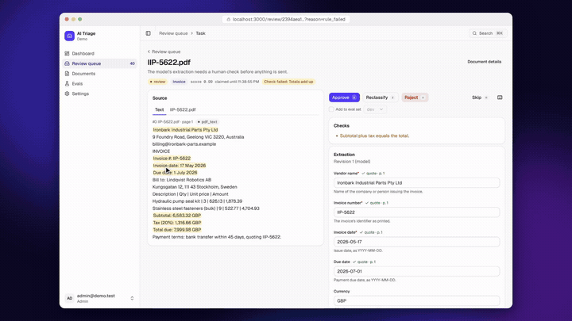
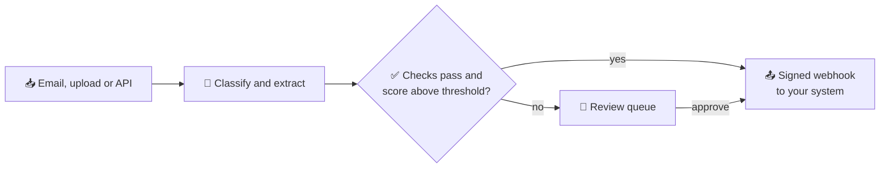
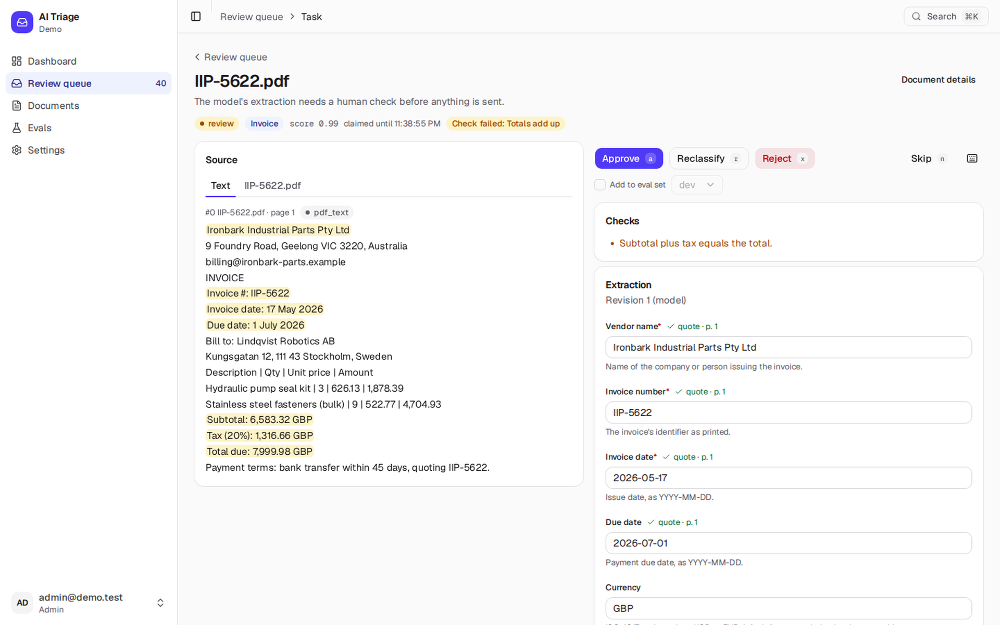
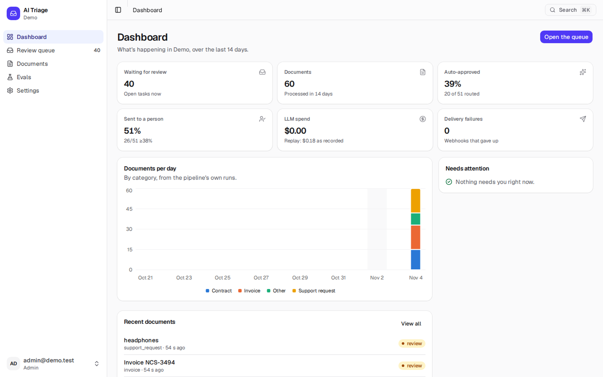
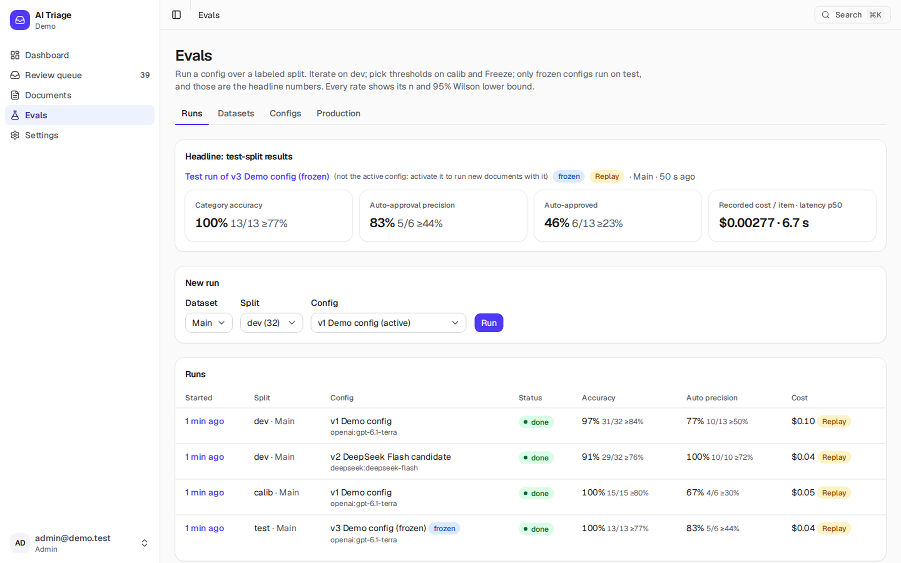

<div align="center">

# ai-triage

**The AI inbox that knows when to ask a human.**

[](https://github.com/visheshgubrani/ai-triage/actions/workflows/ci.yml)
[](https://github.com/visheshgubrani/ai-triage/releases)
[](LICENSE)
[](https://github.com/visheshgubrani/ai-triage/pkgs/container/ai-triage)



</div>

**▶ The full 90-second tour:**

https://github.com/user-attachments/assets/10f7015f-77e9-4ded-b87b-d7bce2b21999

Point your shared inboxes at it: invoices@, support@, contracts@. An AI model reads every email and attachment, works out what it is, and pulls out the fields you care about (vendor, total, due date, severity…), each one backed by a quote from the document. What's clearly right goes straight to your systems. Anything uncertain waits in a review queue for a person, with the reason why.

You decide what gets automated, and you decide it from measured accuracy, not from a demo that looked good once.

It's open source (MIT), self-hosted with one command, and works with Claude, OpenAI, DeepSeek, OpenRouter or a local model.

## Try it in 2 minutes

No API key needed: the demo uses recorded model answers and sample documents.

```bash
curl -fsSL https://raw.githubusercontent.com/visheshgubrani/ai-triage/main/install.sh | sh -s -- --demo
```

Open http://localhost:3000 and sign in as `admin@demo.test` with the password `demo-password`. Port taken? Add `--port 4000`. From a clone, `docker compose up` runs the same demo.

## Why it's different

Pulling fields out of a document with an LLM is easy to demo and hard to trust. ai-triage is built around three rules:

- **It never acts on a guess.** Every value the model extracts must quote the source, and the quote must actually be there. Schemas, required fields, arithmetic (does subtotal plus tax equal the total?), confidence and sender authentication are all checked by plain code. If anything fails, a person looks first.
- **Automation is earned.** Each document type starts with a human reviewing everything. You turn on auto-approval per type after measuring it on labeled data: pick a threshold on one split, freeze it, then confirm it on another. Every number comes with its sample size and an honest error bar.
- **It's yours.** Self-hosted, your choice of model, and your own document types defined in the UI, with no code.

## How it works



1. **In:** documents arrive from a Gmail mailbox, Postmark inbound email, the upload page or the REST API.
2. **Read:** a model sorts each one into a category and extracts its fields against a JSON Schema, quoting the source for each value.
3. **Check:** deterministic gates verify the quotes, the schema, the rules and the sender.
4. **Route:** confident, checked results are approved automatically (only for the categories you've calibrated); everything else goes to a person.
5. **Out:** each approval is delivered to your webhook, signed, at least once, with an idempotency key.

An evals page runs this same pipeline over a labeled dataset, so you can see how good it really is before you trust it.

## Features

- **Any inbox.** Gmail sync (read-only, per mailbox), Postmark inbound for any provider, an upload page, and a REST API with API keys.
- **Your own document types.** Start from scratch or a starter: purchase order, receipt, credit note, shipping notice, refund request, job application, insurance claim, order confirmation. Built-in invoice, support request and contract types add arithmetic and date rules.
- **A fast review queue.** The source on the left with the model's quotes highlighted, the extracted fields on the right with failed checks marked. Keyboard shortcuts for everything; every approval binds to the exact revision on screen.
- **Evals you can believe.** Dev, calib and test splits, threshold sweeps, reliability tables, run-to-run diffs, and cost and latency per item.
- **Scans and photos.** Optional OCR (PaddleOCR-VL, on CPU or GPU), so quotes from scanned documents can be checked too.
- **For teams.** Multiple workspaces, Google sign-in, invitations or Workspace domain join, and TOTP 2FA for admins.
- **Built to keep running.** Per-workspace fairness, provider backpressure, stalled work surfaced instead of silently redone, JSON logs, Prometheus metrics and a System health page.
- **Safe by default.** Webhooks can't reach private networks, secrets are encrypted at rest, every security-relevant change is audited, and production refuses to start on demo defaults.

## Screenshots



| Dashboard | Evals |
|---|---|
|  |  |

## Run it for your team

On your computer, or a server with HTTPS:

```bash
export ANTHROPIC_API_KEY=…    # or OPENAI_API_KEY, DEEPSEEK_API_KEY, OPENROUTER_API_KEY
curl -fsSL https://raw.githubusercontent.com/visheshgubrani/ai-triage/main/install.sh | sh
# a server: … | sh -s -- --host triage.example.com --email you@example.com
# scans too: add --ocr vulkan (AMD or Intel GPU), --ocr nvidia, or --ocr cpu
```

The installer generates every secret, starts everything, prints a one-time setup link for your workspace, and leaves a `./triage` command behind for status, logs, backups and upgrades. Then connect email (forward a mailbox to Postmark, or connect Gmail) and point a webhook at your system. [docs/install.md](docs/install.md) walks through it, including how an AI agent should do the install.

## Develop

Needs Node ≥ 24, pnpm 12 and Docker.

```bash
pnpm install
pnpm dev:setup     # .env, Postgres, storage, a webhook catcher, migrations, demo data
pnpm dev           # http://localhost:3000
```

`pnpm preflight` checks the setup and prints the fix for each problem. [CONTRIBUTING.md](CONTRIBUTING.md) has the checks and conventions.

## Documentation

| | |
|---|---|
| [Using ai-triage](docs/guide.md) | Reviewing, evals, custom categories, Gmail, the API, and known limits |
| [Install](docs/install.md) | The installer, servers, upgrades and backups |
| [API and webhooks](docs/api.md) | The REST API and how to verify webhook signatures |
| [Models](docs/llm.md) | Providers, replay and record modes, and costs |
| [Google](docs/google.md) | Google sign-in and Gmail sync |
| [Security](docs/security.md) | The threat model and the production checklist |
| [Operations](docs/operations.md) | Health checks, logs, metrics and runbooks |
| [Architecture](docs/architecture.md) | The design and the reasons behind it |
| [Configuration](docs/configuration.md) · [Troubleshooting](docs/troubleshooting.md) · [Reliability](docs/reliability.md) | Every setting, fixes by symptom, and load test results |

## Built to be trusted

- **Nothing is lost or done twice.** Each pipeline step saves its result, moves the document forward and queues the next step in one database transaction. Model answers are saved the moment they arrive and reused on retry.
- **Approvals are exact.** An approval binds to one revision and claim, freezes its payload, and the webhook carries a stable idempotency key.
- **Workspaces are isolated in the database itself**, with row-level security on every tenant table.
- **Evals measure the real thing.** An eval run sends byte-identical requests to production's, and can never act: it has no way to approve or deliver anything.
- **No surprise bills.** Replay is the default, live spending is opt-in with a daily budget, and recorded costs are always labeled as recorded.

## Honest limits

- A verified quote proves the text exists in the document, not that it supports the value.
- Without OCR, scans and photos can't be checked, so they always go to a person.
- The prompt-injection tests are regression tests, not proof of resistance; automation stays opt-in per type to keep any mistake small.
- The demo's eval numbers rest on small samples, and the error bars say so.

The full list is in [docs/guide.md](docs/guide.md#known-limits).

## Stack and license

TypeScript · Hono · Next.js · Postgres with Drizzle and pg-boss · S3-compatible storage · optional llama.cpp + PaddleOCR-VL · pnpm and Turborepo · Biome · Vitest · Playwright.

MIT licensed. Security reports: [SECURITY.md](SECURITY.md).
