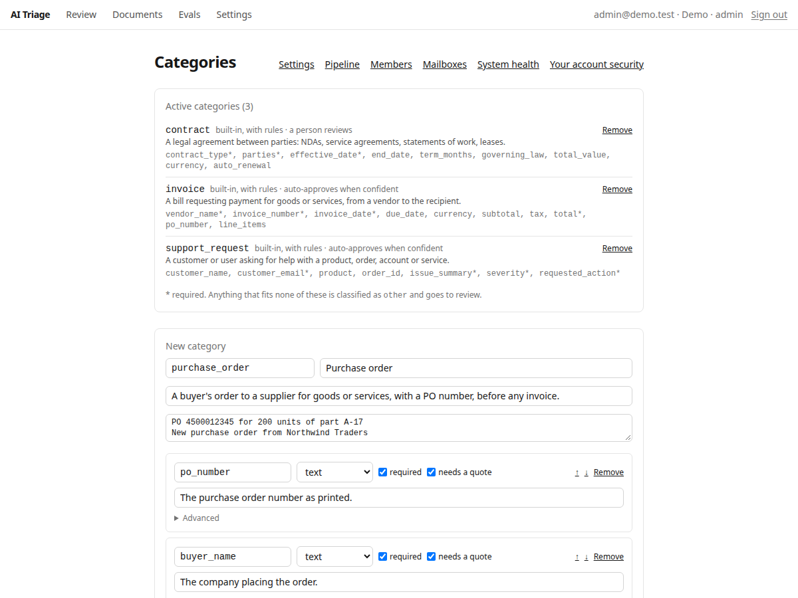
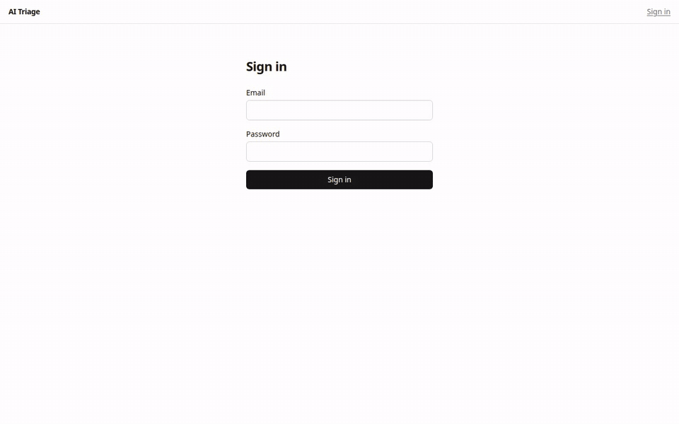
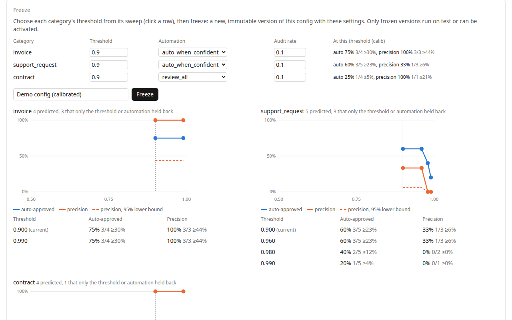
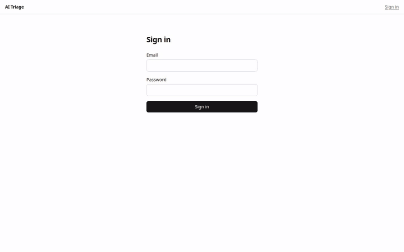

# ai-triage

An open-source AI triage inbox for the documents a company receives by email: invoices, support requests, contracts, and any document type you define.
1. Mail and files come in.
2. A model classifies each one and extracts schema-validated fields.
3. Deterministic checks decide whether it's safe to act on, or whether a person should look first.
4. Approved results go to your systems as signed webhooks.
5. An evals page measures all of it on labeled data, with honest error bars.

It runs anywhere Docker does, with one command, and works with Claude, OpenAI, DeepSeek, OpenRouter or a local model. It's MIT licensed.


## Three ways in

**Try it** (about 2 minutes, no API key: recorded model answers and sample documents):

```bash
curl -fsSL https://raw.githubusercontent.com/visheshgubrani/ai-triage/main/install.sh | sh -s -- --demo
```

Open http://localhost:3000 and sign in as `admin@demo.test` / `demo-password`. From a clone, `docker compose up` runs the same demo.

**Run it for your team**, on your computer or a server with HTTPS:

```bash
export ANTHROPIC_API_KEY=…    # or OPENAI_API_KEY, DEEPSEEK_API_KEY, OPENROUTER_API_KEY
curl -fsSL https://raw.githubusercontent.com/visheshgubrani/ai-triage/main/install.sh | sh
# a server: … | sh -s -- --host triage.example.com --email you@example.com
# scans too: add --ocr vulkan (AMD or Intel GPU), --ocr nvidia, or --ocr cpu
```

The installer:
- generates every secret and starts everything;
- prints a one-time setup link for your workspace;
- leaves `./triage` behind for status, logs, backups and upgrades.

Then connect email: forward a mailbox to Postmark (any provider, no DNS) or connect Gmail, and point a webhook at your system. [docs/install.md](docs/install.md) walks through it, including how an AI agent should do the install.

**Develop it** (Node ≥ 24, pnpm 12, Docker):

```bash
pnpm install
pnpm dev:setup     # .env, Postgres, storage, a webhook catcher, migrations, demo data
pnpm dev           # http://localhost:3000
```

`pnpm preflight` checks the setup and prints the fix for each problem. [CONTRIBUTING.md](CONTRIBUTING.md) has the checks and conventions, and [docs/architecture.md](docs/architecture.md) the design.

## What it does

```
 Postmark inbound ─┐                                     ┌─> Next.js: inbox · review · evals · settings
 Upload (2-step)   ├─> Hono API ─tx─> Postgres (RLS) <───┤   (Hono RPC typed client)
 REST API / CLI   ─┘    insert doc + enqueue (same tx)    │
 Gmail (sync) ─────> worker: poll → history → fetch ──────┤   (per-mailbox OAuth, read-only)
                        │                                 │
                  RustFS/S3 (server-issued keys)          │
 pg-boss ──> worker: parse → classify → extract → route ──┼─> auto (+not sampled) ─> actions outbox ─> signed webhook
                         │ LLM response saved immediately └─> review / audit ─> human ─> actions outbox
                         v
                   model API      (eval runner: same code, results → eval_results only)
```

- **Your own document types.**
  - Define a type and its fields in Settings → Categories: text, numbers, amounts, dates, one-of lists, yes/no, lists, and tables of rows.
  - Start from scratch or from a starter (purchase order, receipt, credit note, shipping notice, refund request, job application, insurance claim, order confirmation).
  - The built-in invoice, support request and contract types add arithmetic and date rules.
- **Nothing acts on a guess.**
  - Each value the model extracts must quote the source, and the quote must be found there.
  - Schema, required fields, confidence and sender authentication are all checked.
  - A category auto-approves only once you've calibrated it, and only above its measured threshold. Everything else goes to a review queue.
- **Scans and photos** can be read with optional OCR (PaddleOCR-VL 1.6, on CPU or GPU), so their quotes can be verified too.
- **Out to your systems:** each approval is delivered as a signed webhook, at least once, with an idempotency key. Other systems can send documents and look up their outcome through a small REST API ([docs/api.md](docs/api.md)).
- **Built to keep running:**
  - per-tenant fairness and provider backpressure;
  - stalled work surfaced, never silently redone;
  - JSON logs and metrics, and a System health page.
  - Load and chaos numbers are in [docs/reliability.md](docs/reliability.md).



## Google Workspace and Gmail

Real teams sign in with Google, join by invitation link or by their Workspace domain, and connect a mailbox (for example `ap@company.com`), whose new mail becomes documents within about a minute. The app only reads the mailbox. Setup and what Google requires: [docs/google.md](docs/google.md).

```bash
pnpm tenant:create --name "Acme" --slug acme --admin you@acme.com   # prints the first admin's invite link
```

The Docker quickstart includes a fake Google, so you can connect a demo mailbox with no Google project: open Settings → Mailboxes, click Connect, then deliver mail into it with `curl --data-binary @fixtures/docs/sup-12.eml http://localhost:9040/fake/deliver`.

## Reviewing

Open http://localhost:3000/review as `reviewer@demo.test`. The queue lists documents waiting for a human, oldest first, with filters by kind, category, reason and age. **Claim next** (`n`) opens the oldest free task and claims it for 10 minutes; the page renews the claim while it's open. On the task page the source is on the left (the email, the PDF, and the extracted text with the model's quotes highlighted) and the extraction on the right, as a form with failed checks marked on their fields.

| Key | Action |
|---|---|
| `a` or `⌘↵` | Approve (**Save & approve** once you've edited a field: the edit becomes a new revision) |
| `r` | Reclassify: the model re-extracts with your category, and the task comes back for review |
| `x` | Reject (final: nothing is sent) |
| `t` | Retry a document whose processing failed |
| `n` | Skip to the next task |

Every approval binds to the exact revision on screen: if anything changed since (another tab approved it, the claim lapsed), the API refuses with 409 and nothing happens. Approved documents are delivered to the tenant's webhook; failures show under **Delivery failures** with **Redeliver**. Admins set the webhook at `/settings`.

Locally, the demo tenant's webhook points at the catcher: open http://localhost:9030 to see each delivery and whether its signature verifies. Add `?status=422` (or any code) to the webhook URL to make it fail.



## Evals

Open http://localhost:3000/evals. The same code that runs in production (parsing, the request builders, output parsing, gates and routing) runs over a labeled dataset, but an eval run can never act: it has no queue, actions or delivery port, and eval items never create documents, which actions require.

- **Datasets** have three splits. Iterate on **dev**. Run the candidate on **calib** and read its threshold sweep (auto-approval rate vs precision per category) and reliability table (does a 0.95 score mean 95% right?), then **Freeze**: a new, immutable config version with the chosen thresholds. Only frozen versions run on **test**, and those are the headline numbers. Activate a frozen version to run new documents with it, with auto-approval for the categories you calibrated. To change models before you have an eval set, use Settings → Pipeline: the new version sends every category to a person, so it needs no calibration.
- **A correct auto-approval** means the right category *and* every required field correct under its comparator (exact, normalized text, date, amount within a cent, set F1 for lists, presence for free text). Category accuracy alone never counts.
- **Every rate shows k/n and its 95% Wilson lower bound.** The demo's calib split has 1 to 5 items per category, so the bounds are wide; that is the honest reading, not a bug.
- **Run A vs run B** lists the items that got worse first. Cost per item (every attempt, so a run costs exactly the sum of its calls) and latency per stage are shown; replayed figures carry a **Replay** badge and say "recorded".
- **Production** shows live cost and latency by day and category, the review and correction rates, and the precision of **audited** auto-approvals (a random sample held for review, weighted by each category's audit rate).
- Grow the dataset from review: **Add to eval set** on an approval (on by default for edits) labels a copy of the document with the values you approved. `pnpm eval:import <items.jsonl>` adds labeled files in bulk.





**A second model.** The demo's replay cassettes cover GPT-6.1 Terra. To compare DeepSeek Flash in replay, record it once (stop `pnpm dev` first; this spends a few cents with your key), then re-run `pnpm db:seed` to add a DeepSeek candidate and its dev run:

```bash
DEEPSEEK_API_KEY=… LLM_MODE=record pnpm cassettes:record --yes --model deepseek:deepseek-flash --effort high
```

DeepSeek Flash can't read PDFs, so scanned documents fail as `unsupported_file` and text PDFs go as text: the run diff shows the difference honestly. With `LLM_MODE=live`, eval runs call the model for real (admins confirm the item count first) and draw on the tenant's daily budget.

## Public API and webhooks

Other systems send documents with `POST /api/v1/documents` (optionally tagged with their own `external_ref`), and look up what happened with `GET /api/v1/documents/:id` or `?external_ref=`. `GET /api/v1/categories` gives each category's JSON Schema. Approved documents are POSTed to your webhook, signed and delivered at least once. The calls, the states, the signature check (Node and Python) and the retry rules are in [docs/api.md](docs/api.md).

## Checks

```bash
pnpm typecheck && pnpm lint && pnpm test && pnpm build
```

`pnpm e2e` runs the Playwright walkthroughs against a running `pnpm dev`: review (edit, approve, stale tab refused, signed delivery, redeliver) and evals (a dev run, Freeze from calib, test on the frozen version, run diff, Add to eval set). `WALKTHROUGH_VIDEO=1` records them, which is where the GIFs above come from.

`pnpm test` includes database tests (tenant isolation, constraints, queue atomicity, auth), which run against a scratch `triage_test` database and need `pnpm infra:up`. `pnpm test:unit` runs without Postgres. CI runs everything on every push.

## Design decisions

- **One transaction per stage**: a stage's result, its status advance and the next job (pg-boss on the same client) commit together, so a crash never loses or duplicates work. Model responses are saved the moment they arrive and reused on retry.
- **Approvals bind to an exact revision** and a claim token; the action payload is frozen at approval, and the webhook carries a stable `Idempotency-Key`.
- **Tenant isolation in the database**: row-level security on every tenant table, composite foreign keys that include the tenant, and server-issued storage keys.
- **Evals measure production, not a copy of it**: eval items store their source the way documents do, so an eval run sends byte-identical requests (a test checks every fixture against the pipeline). Grades are stored per result, so old runs keep the grades they were given.
- **Calibration before the headline**: thresholds come from calib, the config is frozen (a database trigger refuses test runs on unfrozen configs), and only then is test run.
- **No surprise spend**: replay is the default, a missing cassette is a hard error, live budgets are reserved atomically, and a worker refuses an eval run whose LLM mode differs from its own.

## Security

Production refuses to start on the demo's defaults. Webhooks can't reach private networks, and their secrets (and mailbox tokens) are encrypted at rest. Sign-up is by invitation or Workspace domain only. Admins need TOTP 2FA. Every security-relevant change is in an audit log, and documents can be deleted or expire on a retention schedule. [docs/security.md](docs/security.md) has the threat model, the controls and the production checklist. To report a vulnerability, see [SECURITY.md](SECURITY.md).

## Stack and license

TypeScript · Hono (API) · Next.js (UI) · Postgres + Drizzle + pg-boss · S3-compatible storage (RustFS locally) · llama.cpp + PaddleOCR-VL (optional OCR) · pnpm + Turborepo · Biome · Vitest. MIT licensed.

## Known limits

- **Repeated model calls are possible.** Each response is saved as soon as it arrives and reused on retry, but a worker that crashes between Claude answering and that save pays for the call again on retry. Every attempt is kept for cost accounting, and only one is canonical.
- **Evidence matching proves a quote exists, not that it supports the value.**
  - A verbatim quote must appear in the source, or on the cited PDF page.
  - Without OCR, scans and images can't be checked, so they always go to review.
  - With OCR, they're checked against the OCR'd text, which is only as good as the OCR.
- **The prompt-injection fixtures are regression tests, not proof of resistance.** A deterministic gate sends text that addresses the triage system to review, but phrasing it doesn't know gets through to the model. Triage calls have no tools, the only action is a webhook to a tenant-configured target, and automation is opt-in per category, which keeps the damage of a confidently wrong answer small.
- **Inline email images (`cid:`) and remote images aren't shown** in the review view: the HTML is sanitized and rendered with a CSP that blocks remote loads.
- **Free-text fields are graded by presence only.** A summary written in the model's own words can't be graded by string matching, so `issue_summary` counts as right when it is present exactly when the label has one.
- **The demo's eval numbers rest on small samples** (13 test items), and the synthetic fixtures are easier than real mail. The Wilson bounds say how little 5/6 proves.
- **Replay evals need cassettes for their exact requests.** Changing a config's model, effort or prompt in replay mode makes its runs fail as `cassette_missing` until recorded; thresholds and automation don't change requests, so calibration works in replay.
- **Live eval runs share the tenant's daily budget** with production.
- **Deleting a document keeps its eval-set copies.** Items a reviewer added to an eval dataset are separate snapshots; erasing them comes later.
- **Gmail sync polls once a minute** (no push). A mailbox unsynced for more than about a week resyncs only its last 7 days, and mail between users of the same Workspace usually carries no authentication results, so it goes to review (docs/google.md).
- **Replay figures are recorded figures.** In replay mode, tokens, cost and latency come from the cassette, and are labeled as such (`llm_calls.mode = 'replay'`).
